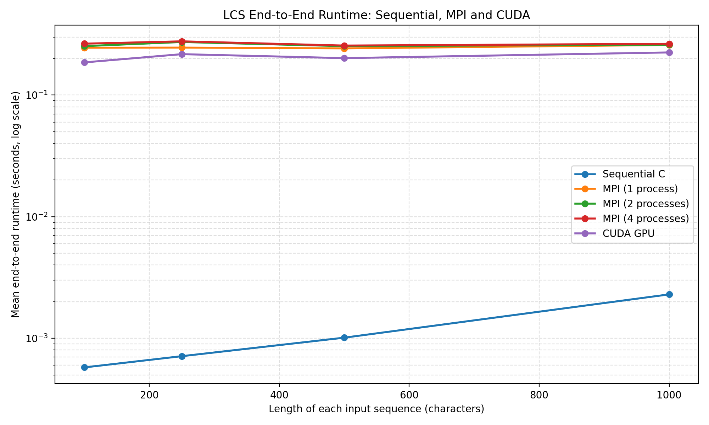
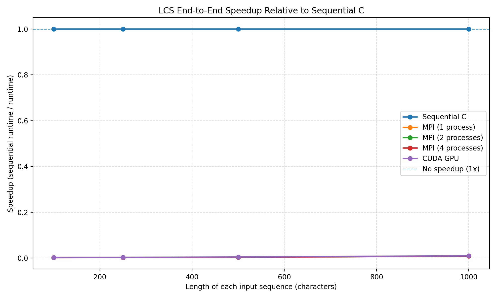
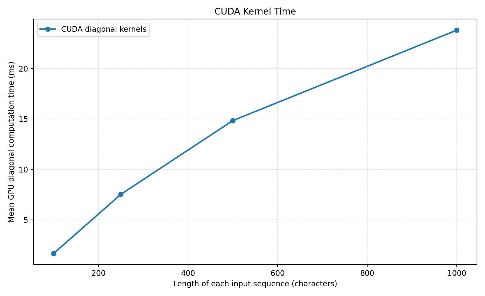

# Parallel Longest Common Subsequence (LCS): C, MPI and CUDA

A comparative implementation of the Longest Common Subsequence (LCS) problem using sequential C, distributed-memory parallelism with MPI, and GPU parallelism with CUDA.

The project explores algorithm design, parallel computation, correctness testing, benchmarking, and performance analysis.

## Project status

- [x] Sequential C implementation
- [x] Automated sequential tests
- [x] MPI implementation using anti-diagonal wavefront computation
- [x] Automated MPI tests
- [x] CUDA implementation using anti-diagonal wavefront computation
- [x] Automated CUDA tests
- [x] Reproducible benchmark scripts
- [x] Performance analysis and plots
- [ ] Extended scalability evaluation
- [ ] Technical report

## 1. Problem description

The Longest Common Subsequence problem consists of finding the longest sequence of characters that appears in two input sequences in the same relative order. Characters do not need to be contiguous.

For example, given:

- Sequence 1: `ABCBDAB`
- Sequence 2: `BDCABA`

One valid longest common subsequence is `BCBA`, with length 4.

The project implements the same problem using three approaches:

1. **Sequential C:** a conventional dynamic programming algorithm.
2. **MPI:** distributes dynamic programming cells across processes using an anti-diagonal wavefront.
3. **CUDA:** computes dynamic programming cells in parallel on an NVIDIA GPU, one thread per cell on each anti-diagonal.

All implementations calculate the LCS length and reconstruct one valid LCS.

## 2. Repository structure

```text
parallel-lcs-mpi-cuda/
├── src/
│   ├── lcs_sequential.c
│   ├── lcs_mpi.c
│   └── lcs_cuda.cu
├── tests/
│   ├── test_sequential.sh
│   ├── test_mpi.sh
│   └── test_cuda.sh
├── scripts/
│   ├── benchmark.sh
│   ├── benchmark.py
│   └── analyze_benchmarks.py
├── results/
│   ├── benchmark.csv
│   ├── benchmark_summary.csv
│   ├── runtime_comparison.png
│   └── speedup_comparison.png
├── .gitignore
├── Makefile
└── README.md
```

## 3. Requirements

### Sequential and MPI implementations

- GCC
- Open MPI
- GNU Make
- Bash

### CUDA implementation

- NVIDIA CUDA Toolkit with `nvcc`
- A compatible NVIDIA GPU and driver
- A host C++ compiler supported by the installed CUDA Toolkit

The current development environment uses GCC for the sequential implementation, Open MPI for MPI, and `g++-14` as the CUDA host compiler.

Python 3 and Matplotlib are required to regenerate the benchmark analysis and plots.

## 4. Build

Build the sequential and MPI implementations:

```bash
make all
```

Build the CUDA implementation:

```bash
make cuda
```

Build all three executables from a clean state:

```bash
make clean
make all
make cuda
```

The generated executables are:

- `lcs_sequential`
- `lcs_mpi`
- `lcs_cuda`

Compiled binaries are excluded from version control.

## 5. Usage

### Sequential C

```bash
./lcs_sequential ABCBDAB BDCABA
```

### MPI

Run with two MPI processes:

```bash
mpirun -n 2 ./lcs_mpi ABCBDAB BDCABA
```

Run with four MPI processes:

```bash
mpirun -n 4 ./lcs_mpi ABCBDAB BDCABA
```

### CUDA

```bash
./lcs_cuda ABCBDAB BDCABA
```

Each implementation should report an LCS length of 4 and a valid LCS, such as `BCBA`.

The implementations may reconstruct different valid subsequences when multiple optimal solutions exist.

Each input sequence is limited to 10,000 characters by the current command-line implementations. Actual feasible input sizes also depend on available memory and execution time.

## 6. Automated testing

Run all three test suites:

```bash
make test
```

Or run them individually:

```bash
make test-sequential
make test-mpi
make test-cuda
```

The current test suites cover:

- The classic LCS example
- Identical sequences
- Sequences with no common characters
- An empty sequence
- A single matching character
- A sequence that is a subsequence of another
- Inputs of different lengths
- MPI execution with different process counts

**Current validation:** all 7 sequential tests, 8 MPI tests, and 7 CUDA tests pass in the development environment.

The tests verify the expected LCS lengths. They do not constitute exhaustive proof of correctness for every possible input.

## 7. Algorithm design

### 7.1 Sequential dynamic programming

Let \(X\) and \(Y\) be the two input sequences. Define \(L(i,j)\) as the LCS length of their first \(i\) and \(j\) characters.

The recurrence is:

\[
L(i,j)=
\begin{cases}
0 & i=0 \text{ or } j=0\\
L(i-1,j-1)+1 & X_i=Y_j\\
\max(L(i-1,j),L(i,j-1)) & X_i\ne Y_j
\end{cases}
\]

The full dynamic programming table is filled row by row, then traversed backwards to reconstruct one LCS.

- Time complexity: \(O(mn)\)
- Space complexity: \(O(mn)\)

Here, \(m\) and \(n\) are the sequence lengths.

### 7.2 MPI distributed computation

The MPI implementation processes the dynamic programming table by anti-diagonals. Cells on the same anti-diagonal can be computed concurrently once the required previous diagonals are available.

Each process computes a subset of the cells on the current anti-diagonal. `MPI_Allreduce` combines the local results so that all processes can access the values needed for the next step.

This approach demonstrates distributed computation but incurs communication overhead on every anti-diagonal.

The distributed phase calculates the LCS length. Rank 0 then performs a sequential dynamic programming pass to reconstruct the actual subsequence.

Consequently, the MPI implementation does not parallelize the complete end-to-end workflow. Its measured total runtime includes both distributed computation and sequential reconstruction.

### 7.3 CUDA GPU computation

The CUDA implementation also uses anti-diagonal wavefront computation.

For each anti-diagonal:

1. The host determines the valid range of cells.
2. CUDA threads are launched to calculate those cells in parallel.
3. The device rotates the buffers holding the previous two diagonals and the current diagonal.
4. The process continues until the final diagonal has been calculated.

The LCS length is copied back from the GPU. A CPU dynamic programming pass then reconstructs one valid LCS for display.

The reported GPU computation time measures the diagonal-kernel phase using CUDA events. It excludes device allocation, host-to-device input copies, result transfer, and CPU reconstruction.

This timing is useful for examining GPU computation, but it is not directly equivalent to end-to-end program runtime.

## 8. Benchmarking and performance analysis

The benchmark suite compares Sequential C, MPI, and CUDA using reproducibly generated DNA-like sequences over the alphabet `ACGT`.

### Methodology

The benchmark script uses fixed random seeds to generate identical input pairs for every implementation at each sequence length. It tests lengths of 100, 250, 500, and 1,000 characters, with three measured repetitions per configuration.

The tested configurations are:

- Sequential C, one process
- MPI with 1, 2, and 4 processes
- CUDA on the available NVIDIA GPU

The script checks that all implementations return the same LCS length. CUDA is warmed up before its measured runs.

End-to-end runtime is measured using Python's `time.perf_counter()` around each complete program invocation. These measurements include process startup and LCS reconstruction. CUDA end-to-end time also includes GPU initialization, memory allocation, and data transfers.

CUDA kernel time is recorded separately using the timing reported by the CUDA program. It measures the diagonal-kernel phase and excludes memory allocation, input transfers, and CPU reconstruction. It must not be treated as equivalent to end-to-end runtime.

### Results

The following values are the mean end-to-end runtimes measured in the current experiment.

| Input length | Sequential C | MPI (1 process) | MPI (2 processes) | MPI (4 processes) | CUDA |
|---:|---:|---:|---:|---:|---:|
| 100 | 0.000576 s | 0.244971 s | 0.252494 s | 0.264593 s | 0.185573 s |
| 250 | 0.000713 s | 0.245649 s | 0.272988 s | 0.276573 s | 0.216950 s |
| 500 | 0.001012 s | 0.242054 s | 0.252475 s | 0.255267 s | 0.201196 s |
| 1,000 | 0.002297 s | 0.258155 s | 0.259593 s | 0.264009 s | 0.224144 s |

For these input sizes, Sequential C was the fastest implementation. CUDA was faster than the tested MPI configurations in end-to-end runtime, but did not outperform the sequential baseline.

At length 1,000, the mean CUDA diagonal-kernel time was approximately 23.81 ms, while mean CUDA end-to-end runtime was approximately 224.14 ms. The difference illustrates why kernel-only timings and complete application timings must be reported separately.

The MPI implementation performs a collective communication operation on every anti-diagonal and reconstructs the subsequence sequentially on rank 0. The CUDA implementation launches a kernel for each anti-diagonal and reconstructs the subsequence on the CPU. These design choices introduce overhead that can dominate the computation at the tested sizes.

These measurements describe this implementation and test environment only. They do not establish that CUDA or MPI is inherently slower than sequential computation. Larger workloads, optimized algorithms, and additional experiments are needed to assess scalability.

### Benchmark artifacts

The benchmark measurements are stored in `results/benchmark.csv`. Summary statistics are written to `results/benchmark_summary.csv`.

The scripts can regenerate the measurements, summary statistics, and plots:

```bash
python3 scripts/benchmark.py
python3 scripts/analyze_benchmarks.py
```

#### End-to-end runtime



#### Speedup relative to Sequential C



#### CUDA kernel computation time



## 9. Limitations and future work

Potential improvements include:

- Extend automated tests with randomized inputs and cross-implementation comparisons.
- Improve MPI communication efficiency and evaluate alternative work-distribution strategies.
- Investigate CUDA approaches that reduce kernel-launch overhead.
- Add CUDA to the benchmark harness and distinguish end-to-end runtime from GPU kernel time.
- Evaluate larger input sizes and additional process counts.
- Document the hardware and software environment for every performance experiment.
- Complete a technical report describing implementation choices, correctness validation, experimental methodology, and results.

## 10. Reproducibility

To rebuild the executables and run the automated tests:

```bash
make clean
make all
make cuda
make test
```

To regenerate the sequential and MPI benchmark measurements and their analysis:

```bash
python3 scripts/benchmark.py
python3 scripts/analyze_benchmarks.py
```

Recorded benchmark files are retained in the repository so that the published results can be inspected without rerunning the experiments.

## License

No license has been specified yet. Add an appropriate license before explicitly permitting reuse or redistribution of this project.
